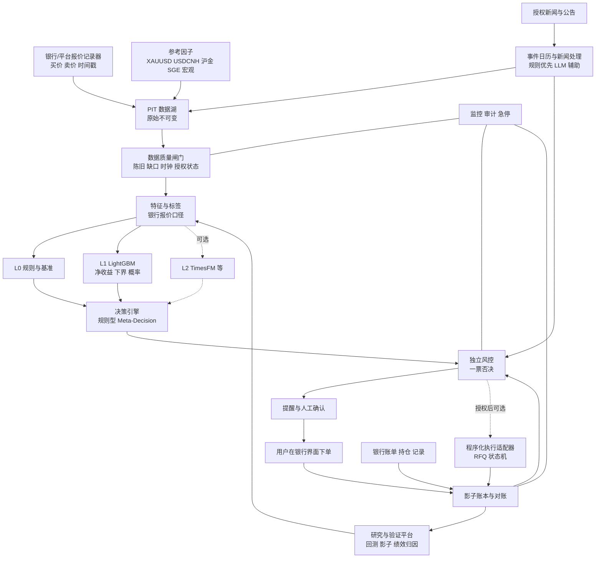
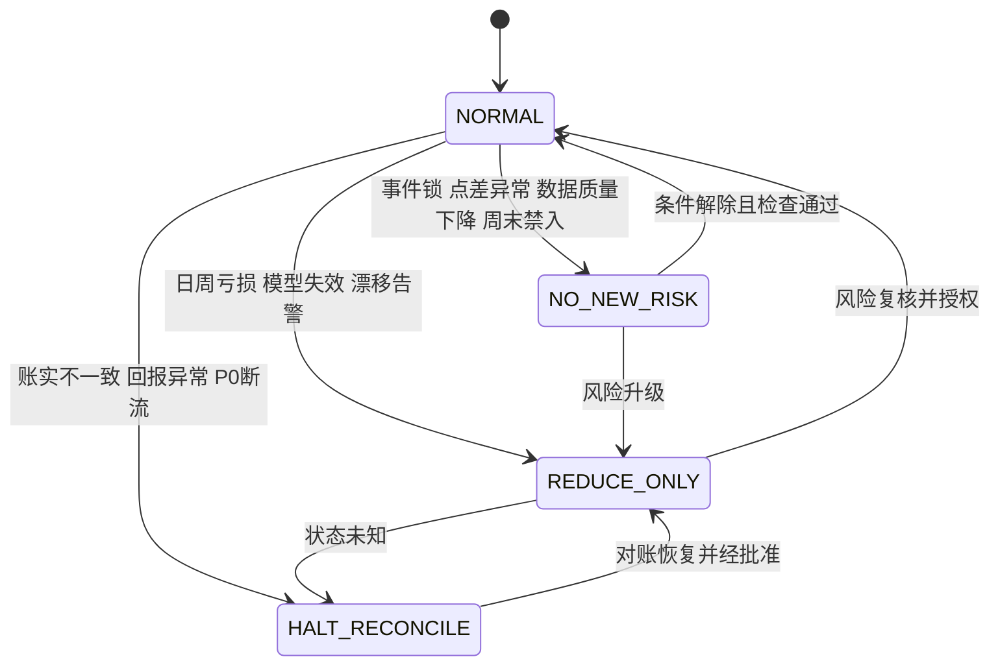
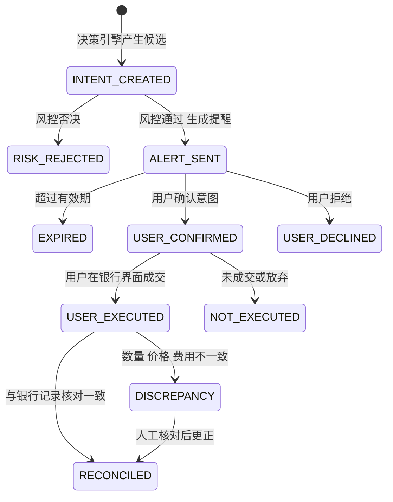

# 浙商银行财富金积存 量化决策与执行系统 V5.0 实施计划（银行产品版）

> 版本：V5.0（由 V4.1 经审计后整体重写）｜编制日期：2026-11-16
> 状态：研究与工程建设基线。**不是投资收益承诺，也不是上线许可。**
> 适用范围：仅限本计划定义的产品与渠道。授权、适当性、协议条款类结论须以银行、合作平台及法务的书面意见为准；本文不构成法律或投资意见。
> 与前版关系：本文取代 V4.1 的第 0–20 章及附录 A–J。V4.1 中关于 SGE Au99.99 的内容不再作为交易规则，仅作为"参考因子研究"保留在附录 D。

---

## 0. 执行摘要与变更说明

### 0.1 一句话定位

**为浙商银行财富金积存建立一套"成本诚实、数据可追溯、风险先行"的低频决策系统：默认形态是信号提醒加人工确认下单；自动下单只在取得书面授权并通过闸门后作为可选增量。**

### 0.2 相对 V4.1 的核心变更

| # | 变更 | 原因（对应审计项） |
|---|---|---|
| 1 | 新增 **G-1 经济可行性闸门**，放在所有工程之前 | S1：0.4% 卖出费与分钟级窗口量级不相容 |
| 2 | 主持有期由"5/15/30/60 分钟"改为"**小时到周**"；5 分钟仅作数据节拍与风险监测 | S1、M9 |
| 3 | 默认交付改为"**提醒 + 人工确认**"；自动下单为可选且需授权 | S2 |
| 4 | **第 0 天**启动银行/平台报价记录器；成为全项目关键路径 | S3 |
| 5 | 模型栈改为**分层准入**：规则 → LightGBM →（可选）TimesFM / News LLM；设试验预算与多重检验修正 | S4、M10 |
| 6 | 执行层由"交易所撮合模型"重写为"**报价接受（RFQ）模型**" | H1 |
| 7 | 风险口径统一为**净退出损失**（含卖出费、价差）；新增**周末风险桶** | H2、H3 |
| 8 | 利息在回测与标签中默认记 0，仅作对账项 | H4 |
| 9 | 卖出规则造成的**碎片库存**纳入仓位引擎与状态机 | H5 |
| 10 | 增加载体对比与资金规模论证 | H6、H7 |
| 11 | fail-closed 条件改为**银行/平台报价流与账户回报断流** | M4 |
| 12 | 条款、数据使用权限、供应链列入 G0 硬性验收 | SEC1–SEC3 |

### 0.3 成功标准

成功不是模型多、胜率高，而是同时满足：

1. **扣费后**、在**独立样本外**、对**简单基准**仍有可复现的净收益优势（或明确结论：没有，因此不交易）；
2. 在成本加倍、点差扩张、周末跳空等压力情景下仍可承受；
3. 账户、持仓、成本与利息可与银行记录**对账一致**；
4. 全程合规、可审计，且任何一个依赖失效时系统**安全降级**。

"结论为不交易或仅提醒"是**合法的成功结果**，不应被当作项目失败。

---

## 1. 范围、定位与假设

### 1.1 产品与渠道

| 项目 | 内容 |
|---|---|
| 交易对象 | 浙商银行财富金积存，`instrument_id = CZB.WEALTH_GOLD_ACCUMULATION` |
| 参考因子 | SGE Au99.99、国际金价（XAU/USD）、USD/CNH、沪金期货、宏观与新闻，仅作特征，**不是成交价** |
| 交易方向 | 只做多或空仓；不加杠杆；卖出不超过账户可用克重 |
| 默认执行形态 | 系统产生信号与风险提醒，**人工在银行/平台界面确认并下单**，系统记录并对账 |
| 可选执行形态 | 经书面授权的程序化下单（见 G0、G4）；未获授权则不开启 |
| 禁止 | 未经授权的接口、网页模拟点击、逆向抓取、绕过限频或鉴权 |

### 1.2 产品规则快照（用户提供，**未经银行官网复核**）

所有规则作为**带版本的参数**，不写死为常量。上线前须逐项以银行及平台当日公告核对，并保存证据。

| 参数 | 快照值 | 备注 |
|---|---|---|
| `buy_fee_rate` | 0% | 优惠费率，可变 |
| `sell_fee_rate` | 0.4%（40bp） | 以卖出金额为基数 |
| 买入最小量 | 1 克 | 精度以回报验证 |
| 卖出规则 | 持仓 >1 克：单笔至少 1 克；持仓 ≤1 克：须一次性全卖 | 产生碎片库存，见 §10.4 |
| 连续交易时段 | 周一 09:00 至周六 02:30 | 休市约 54.5 小时（周六 02:30 至周一 09:00），另含节假日与临时调整 |
| 非交易时段挂单 | 次开盘批量价与期望价比较成交 | **不是**限价单，需单独建模 |
| 活期年化 | 0.02%，360 日基数，0.0001 克发放门槛 | 回测默认记 0，见 §7.5 |
| 适当性 | R3 产品；C3 平衡型及以上客户 | 以银行实际审核为准 |
| 报价机制 | 银行综合参考上金所、上期所、国际金价形成买价与卖价 | 非单一市场报价 |

### 1.3 不得直接当作事实的假设

1. 银行或平台允许合规的程序化访问与下单。
2. 京东 Skill、BFF、财富网关的路径、字段、权限、限频与使用条款（附录 C 仅为待验契约）。
3. 24–36 个月银行历史双边报价存在。**目前不存在。**
4. TimesFM 3.0 的多变量、微调与商用许可（须按拟用版本核实）。
5. Qlib 在本场景（单标的、低频、自定义日历）的兼容性（须版本级测试）。
6. 任何收益、胜率或阈值。文中所有阈值为**候选**，须在立项时冻结，不得看到结果后改写。

---

## 2. 闸门体系（Go / No-Go）

任一闸门失败，只能：维持当前阶段、降级形态、或终止；**不得通过叠加模型复杂度绕过**。

| 闸门 | 名称 | 通过条件（摘要） | 失败后的动作 |
|---|---|---|---|
| **G-1** | 经济可行性 | 存在至少一个持有期，在合理点差假设下"所需方向准确率"落在可达范围，且独立样本数足以检验（§3） | 降级为"提醒/影子"，或终止 |
| **G0** | 授权与合规 | 书面确认：产品适当性、数据使用范围（存储/再利用/训练）、程序化访问条款；如需自动下单，另需写接口与续期机制；模型与软件许可 | 停止相应分支；无自动授权则仅提醒 |
| **G1** | 数据与 PIT | 银行报价样本达到冻结的覆盖、质量、时间戳标准；PIT 链可重放；日历正确 | 保持"代理研究"标注，不宣称可成交 |
| **G2** | 模型与验证 | 基准与各层增量在冻结阈值上通过；无泄漏；试验预算内；多重检验修正后仍成立 | 回到简单基准或"不交易" |
| **G3** | 影子经济性 | 实时影子运行达到冻结时长与样本；净收益、回撤、对账、提醒质量达标 | 不进入自动下单评估 |
| **G4** | 生产安全（仅自动下单分支） | 故障演练、对账、凭据、回滚、人工急停通过；授权有效 | 不得自动报单 |

**闸门阈值冻结规则**：每个闸门的定量阈值须在运行前写入《验收阈值冻结文件》并签核；之后只可因外部规则变更而修订，且保留版本。

---

## 3. G-1：经济可行性分析（先于一切工程）

### 3.1 目的

用最小成本回答：**扣掉卖出费与价差后，是否存在可交易的空间。**

### 3.2 基本关系

设单笔做多，赢时盈利幅度与输时亏损幅度均约 *m*（对称近似），往返总成本 *C*（含卖出费、价差、其他成本），方向准确率 *p*：

```text
期望净收益 = p·m − (1−p)·m − C ≥ 0
⇒ 所需准确率 p* = 0.5 + C / (2m)
```

*m* 用持有期内价格绝对变动的典型值代理。这是**方向判断的下界要求**，不含模型不确定性与样本误差。

### 3.3 量级示意（σ=年化 17%，C=0.5%，仅示意，须用实测数据替换）

| 持有期 | 典型绝对变动 *m*（≈0.8σ_h） | 所需准确率 *p\** | 评价 |
|---|---:|---:|---|
| 30 分钟 | ≈0.12% | >100% | 不可能 |
| 1 日 | ≈0.85% | ≈79% | 极难 |
| 1 周 | ≈1.9% | ≈63% | 困难 |
| 2 周 | ≈2.7% | ≈59% | 边缘 |
| 1 个月 | ≈3.9% | ≈56% | 可能但交易极少 |

结论方向：**成本结构天然偏向"低频、长持有"**。分钟级窗口无正期望空间；小时到日级也需极高的预测能力。

### 3.4 分析清单

1. **盈亏平衡覆盖率**：对持有期 {1h, 4h, 1d, 3d, 1w, 2w, 1m}，统计价格变动超过盈亏平衡点（含实测价差）的频率，分涨跌方向。
2. **所需准确率曲线**：对点差 {0.05%, 0.1%, 0.2%, 0.3%} 重复 §3.2。
3. **方向可预测性上限**：用简单因子（动量、均线、波动状态）估计样本外方向准确率区间，检验是否超过 *p\**（附置信区间）。
4. **周末与开盘跳空**：统计周五收盘至周一开盘的变动分布。
5. **基准**：不交易、一次性持有、定投、周五减仓规则。
6. **独立样本数**：按持有期折算可用的互不重叠样本数；样本不足则标记"无法检验"。

### 3.5 通过判据（运行前冻结的模板）

- 至少一个持有期在**冻结的点差假设**下，简单因子样本外准确率的置信区间下界 ≥ *p\**；
- 或在无预测能力假设下，某一"规则型"策略（如周末风险规避）相对基准的扣费净改进在置信区间内为正；
- 独立样本数 ≥ 冻结下限；
- 否则 G-1 不通过。

### 3.6 G-1 不通过的出口

- **出口 A**：缩减为"提醒与对账工具"（价格提醒、费用与盈亏平衡计算、周末风险提示、账务对账），不含预测模型；
- **出口 B**：终止预测模型与自动交易，仅保留知识沉淀。

---

## 4. 载体比较与资金规模论证

### 4.1 载体对比（立项时填写，来源须书面可查）

| 维度 | 财富金积存（本项目） | 其他可选载体（占位） |
|---|---|---|
| 往返成本（费用+价差） | 买 0% + 卖 0.4% + 银行点差 | 待填 |
| 交易时间 | 周一 09:00 至周六 02:30 | 待填 |
| 报价机制 | 银行报价（RFQ 性质） | 待填 |
| 可程序化性与授权 | 待 G0 | 待填 |
| 持有成本/收益 | 活期 0.02%，可近似为 0 | 待填 |
| 最小单位与碎片规则 | 1 克起；卖出规则见 §1.2 | 待填 |

若本产品是用户既定约束，须在此显式声明，并把目标设定为"**在既定载体内的低频最优，或结论为不交易**"。

### 4.2 资金规模与投入产出

立项时必须填写并冻结：

| 项 | 内容 |
|---|---|
| 账户规模（人民币） | 待填 |
| 单笔最小成本（1 克对应金额） | 待填 |
| 预期收益上限情景（保守/中性/乐观，均扣费） | 待填 |
| 数据、算力、人力成本（年化） | 待填 |
| 投入产出比 | 待算 |

**判据**：若扣费后的收益上限无法覆盖工程与数据成本，工程范围应缩减至 §3.6 出口 A 的水平。

---

## 5. 总体架构

### 5.1 原则

- 模块化单体或少量服务，避免过度微服务化。
- **银行账单为账务权威**；系统账本为影子账本，须与银行记录对账。
- 研究、影子、（可选）生产环境隔离，凭据不跨环境。
- 模型只产生**候选建议**；风控一票否决；所有决策可追溯。

### 5.2 逻辑架构



### 5.3 与 V4.1 的结构差异

| V4.1 | V5.0 |
|---|---|
| SGE Tick/盘口为 P0 数据 | **银行/平台双边报价与账户回报为 P0** |
| 专用 Tick 事件回测与撮合 | 报价序列回放 + **RFQ 成交模型**（延迟、滑点、拒单） |
| 5/15/30/60 分钟多窗口融合 | 小时到周的主窗口；多窗口融合降为可选研究 |
| 自动实盘为主线 | 提醒加人工确认为主线，自动为可选 |
| TimesFM、News LLM 为核心 | 分层准入，须证明增量 |

---

## 6. 数据体系

### 6.1 数据优先级

| 级别 | 数据 | 用途 | 验收项 |
|---|---|---|---|
| **P0** | 银行/平台买价、卖价、报价时间戳、可成交标志 | 成交价、点差、成本、标签 | 授权、时间戳、频率、完整性 |
| **P0** | 账户资金、克重（可用/冻结）、成本、订单与成交记录 | 对账、风控 | 账实一致 |
| **P0** | 产品规则、费率、日历、公告（带生效时间） | 成本与可交易性 | 版本证据 |
| P1 | XAU/USD、USD/CNH、沪金、SGE Au99.99 | 领先与基差因子 | 授权、时区、延时 |
| P1 | 宏观日历、预期与实际值 | 事件锁与风险 | 预期快照 |
| P2 | 新闻、官方公告 | 事件风险标志 | 首发时间、去重 |
| P2 | 京东公开行情与财富网关指标 | 辅助特征候选 | 附录 C |

### 6.2 银行/平台报价记录器（**第 0 天启动**）

**目标**：持续记录银行客户买入价与卖出价，积累本产品的真实成本与点差分布。这是长周期瓶颈，越早越好。

记录字段：

| 字段 | 说明 |
|---|---|
| `quote_id`、`source_id` | 唯一标识与来源（接口或页面） |
| `bid_price`、`ask_price` | 客户卖出价、客户买入价（以客户方向命名，须与来源定义核对） |
| `quote_at` | 来源时间戳（含时区） |
| `received_at` | 本地接收时间 |
| `available_at` | 通过质量校验后可用于决策的时间 |
| `is_tradable` | 是否可成交（休市、暂停等） |
| `response_code`、`payload_hash` | 响应状态与原文哈希 |
| `quality_state` | 正常 / 陈旧 / 缺口 / 异常 |

运行要求：

- 频率与方式须符合平台条款与限频；不得通过绕过限制采集。
- 7×24 运行，覆盖周末、节假日、重大数据发布；记录采集器自身的停机与缺口。
- 原始数据不可变存档，生成每日校验和。
- 数据使用权限（存储、再利用、训练）在 G0 中书面确认；未明确前仅存必要字段，并保留删除能力。

### 6.3 PIT 时间链

每条数据保留：`event_time → published_at → received_at → available_at → decision_at → eligible_at`，以及 `source_id`、`instrument_id`、`revision_id`、`quality_state`、`feature_version`。

- 回放统一使用 `available_at <= decision_at`。
- 宏观数据按当时公布版本，不使用后续修订值；新闻使用首发时间。
- 不虚构休市期可成交价；缺口以掩码标识，不无条件前向填充。

### 6.4 银行产品日历 `CZBSessionCalendar`

- 连续交易区间：周一 09:00 至周六 02:30，排除节假日与临时调整（以公告为准，带生效版本）。
- **休市状态**（含周末约 54.5 小时）为一等状态，不生成"可成交"柱。
- "有效 K 线"仅指交易时段内由银行报价形成的柱；5 分钟为数据节拍，**不等于**交易频率。
- 闭市挂单与批量成交有独立日历与状态（§11.6）。

### 6.5 参考因子口径

国际折算：

```text
P_intl_CNY_per_g = XAUUSD × USDCNH / 31.1034768
bank_basis = bank_mid / P_intl_CNY_per_g − 1
```

`bank_basis`、银行报价相对参考源的滞后与点差扩张，是银行产品特有的**重要特征**，须以银行报价历史验证；不得把"预测 SGE 价格"当作"预测银行卖出价"。

### 6.6 数据质量规则

时钟同步；乱序与重复；负价格或负点差；异常跳价；断流阈值（按来源配置）；跨源交叉校验；授权状态。**任何 P0 来源断流或失效时，禁止新增风险**（§10.6）。

---

## 7. 标签、特征与成本口径

### 7.1 成本与盈亏

```text
entry_cash_out = q × P_ask_exec × (1 + buy_fee_rate)
exit_cash_in   = q × P_bid_exec × (1 − sell_fee_rate)
net_pnl        = exit_cash_in − entry_cash_out − verified_other_costs
break_even_bid = P_ask_exec × (1 + buy_fee_rate) / (1 − sell_fee_rate)
```

- 买入使用银行实际买入成交价，卖出使用银行实际卖出成交价；**银行双边价差已体现在两侧报价中，不得再重复扣一次**。
- 无点差的下界：`1/(1−0.004)−1 ≈ 0.4016%`；买入 1000 元/克时，卖出价至少约 1004.016 元/克。**含实测点差 s 后，盈亏平衡需上涨约 0.4016% + s**。
- 历史缺少真实银行报价时，使用**经观测校准的保守点差与延迟情景**，并标注"代理成本回测"，**不得宣称真实可成交回测**。

### 7.2 标签

| 标签 | 定义 |
|---|---|
| `net_return_h` | 持有期 h 内以银行可实现价、扣费后的净收益率 |
| `win_h` | `net_return_h > 0` |
| `mae_h` | 持有期内最大不利变动（用于风险与止损） |
| `exit_feasible_h` | 是否存在可成交退出（不跨不可处理的休市、不遇报价断流） |
| `weekend_gap_h` | 持有跨周末时的开盘跳空幅度 |

**持有期集合（候选）**：{4 小时, 1 日, 3 日, 1 周, 2 周, 1 个月}；5/15/30/60 分钟仅用于风险监测与入场时点辅助，不作为独立开仓依据。

### 7.3 防泄漏

- 入场价取决策后**最早可成交报价加延迟情景**，不使用决策时的收盘或中间价。
- 重叠标签执行 purge 与 embargo，embargo 不短于最大持有期。
- 所有滚动预测须为"当时可得"的样本外预测。
- 记录试验次数（§12.4）。

### 7.4 特征族

| 族 | 示例 | 备注 |
|---|---|---|
| 价格与趋势 | 多周期收益、均线偏离、动量 | 基础 |
| 波动状态 | 实现波动、ATR、波动比 | 风险与门控 |
| 银行报价微结构 | 点差、点差变化、报价更新间隔、quote age | 银行特有 |
| 基差与领先 | `bank_basis`、国际金价领先滞后 | 须验证增量 |
| 日历 | 距周末休市时间、距开盘时间、节假日 | 周末风险 |
| 事件 | 宏观日历距离、新闻风险标志 | 规则优先 |
| 持仓状态 | 当前克重、成本、浮盈浮亏、持有时长 | 仅用于仓位与退出 |

### 7.5 利息

- 日息克重 = 持仓克数 × 0.0002 / 360 ≈ 持仓克数 × 5.56×10⁻⁷；达到 0.0001 克发放门槛约需 **180 / 持仓克数** 天。
- 相对 0.4% 卖出费可忽略，且门槛表述、卖出时未分配利息归属均未确认。
- **回测与标签中默认利息 = 0**。仅在对账中记录 `interest_pending_g`、`interest_credited_g`，待银行账单实测后再决定是否进入账务。

---

## 8. 模型栈（分层准入）

### 8.1 总原则

1. 从简单开始，**每新增一层，必须在预先冻结的阈值上显示扣费后的样本外增量**，否则不进入下一层。
2. 设**试验预算上限**，超出须重新审批（§12.4）。
3. 任何模型失效或超时，回退到上一层已批准版本；无回退则禁止新开仓。

### 8.2 层级

| 层 | 内容 | 准入条件 |
|---|---|---|
| **L0** | 基准与规则：不交易、一次性持有、定投、阈值趋势、周五减仓、波动门控 | 作为所有比较的对照；必须先行 |
| **L1** | LightGBM：预测 `E[net_return_h]`、其置信下界与盈利概率；概率须校准 | 相对 L0 有扣费后样本外增量 |
| **L2（可选）** | TimesFM 等基础时序模型：零样本预测或外部校准；输出作为 L1 的特征 | 相对 L1 有增量；许可已核实（G0） |
| **L3（可选）** | News LLM：结构化事件提取，输出**风险标志**，不直接下单 | 先作为风险与审计辅助；有净收益增量才进入预测特征 |
| **L4（可选）** | 多窗口动态融合 | 相对"固定主窗口"在成本与延迟压力下仍有增量 |

### 8.3 LightGBM 要点

- 目标：`net_return_h` 回归，辅以 `win_h` 分类；输出分位数或置信区间以得到**下界**。
- 在时间顺序的独立校准集上校准概率；报告 Brier、ECE、分组校准、校准漂移。
- 小样本策略：控制树数与深度，优先正则化与特征精简；报告特征稳定性。
- 不得以胜率作为唯一目标，须同时看盈亏不对称。

### 8.4 TimesFM（可选，须先过 G0）

- 许可与部署方式须按**实际拟用版本**书面核实；研究用权重不得直接用于商业生产服务。
- 研究顺序：T0 零样本 → T1 冻结基础模型加外部校准 → T2/T3 仅当 T1 不足且样本外增量明显。
- 不把未来才知道的价格、汇率、宏观值作为未来协变量；仅交易日历等事前确定量可用。
- 先在**小时到日级**检验，不默认保留多上下文窗口矩阵。

### 8.5 News LLM（可选）

- 预定日程类事件（CPI、非农、FOMC 等）由**规则日历**提前产生事件锁，**不等 LLM**。
- LLM 仅做：去重聚类、结构化提取、可信度与严重度标注；不预测未公布数字。
- 来源未知或冲突时不改变方向，只触发保守风控。
- 验收：重大风险漏报率、去重质量、时间可用性、延迟、交易增量。无增量则仅保留为风险标志与审计辅助。

### 8.6 Qlib 的定位

- 用于数据处理、实验记录与滚动验证的**研究工具**，不是必须项。
- 不直接套用股票横截面 Alpha158/Alpha360 + TopkDropout；需自定义单标的 DataHandler、`CZBSessionCalendar` 与银行成本标签。
- 引入前须在指定版本上做分钟/小时频、自定义日历与标签的兼容性测试。若集成成本高于收益，可改用 Parquet/DuckDB + 自建管线与 MLflow。

---

## 9. 决策引擎（规则型 Meta-Decision）

### 9.1 职责

整合：模型预测与置信下界、成本估计、市场状态、事件锁、数据质量、持仓状态、周末规则。输出**交易候选或弃权理由**；风控拥有一票否决权。

### 9.2 输出契约

`decision_id, decision_at, action(BUY/HOLD/SELL/ABSTAIN), delta_g, target_inventory_g, horizon_primary, forecast_ids, expected_net_return, net_return_lcb, win_probability, expected_cost, uncertainty, risk_flags, quality_state, reason_codes, expires_at`。

### 9.3 决策顺序

1. 数据质量失败、授权失效、非交易时段（且不允许挂单）→ `ABSTAIN`，允许受控的减风险提示。
2. 事件锁、点差异常扩张、报价陈旧 → 禁止新开仓。
3. 预测已过期、各模型严重冲突或不确定性过大 → `ABSTAIN`。
4. **开仓条件**：`net_return_lcb(h_primary) > θ_edge`，且预期净收益、下行风险、点差、周末规则均满足（见 §9.4）。
5. 通过后交风控检查资金、库存、风险状态与碎片规则。
6. 全程持久化输入版本、判决原因与时间戳；同一 `decision_id` 幂等。

### 9.4 开仓与退出规则（候选，须冻结）

**开仓**：

```text
BUY 候选 ⇔ LCB(E[net_return_h]) > θ_edge
          且 当前点差 ≤ 点差上限
          且 不在 EVENT_LOCK / DATA_INVALID / 周末禁入窗口
          且 持仓与暴露在限额内
```

- 门槛以**期望净收益的置信下界**为准，概率（如 P>0.6）只作辅助，因为胜率会掩盖盈亏不对称。
- `θ_edge` 须覆盖估计误差与再进入成本，**不得**低于零，具体值由样本外验证选定后冻结。

**退出**（持仓时）：

- 卖出费无论何时卖出都要支付，因此"是否卖出"主要比较**未来价格路径的预期与风险**；但若卖出后计划再买回，则需额外支付"卖出费 + 价差"，故：
  - 计划再买回：仅当预期下跌幅度的置信上界 < −（再进入成本）时才 SELL；
  - 兑现离场：比较继续持有的风险调整预期与风险预算。
- 触发条件：止损提示、风险状态升级、事件锁、周末规则、持有期到达后的**新增边际收益**为负。
- **滞回**：开仓与退出采用不同门槛，设最短稳定观察，避免反复交易。

### 9.5 周末与休市规则（候选，须回测后冻结）

- 周五收盘前 *X* 小时起，禁止新开仓或仅允许小额；
- 周六 02:30 前评估：是否减仓以把"周末风险桶"控制在限额内；
- 周末风险桶：持仓市值 × 历史周末跳空分布的下尾分位 ≤ 限额；
- 闭市挂单仅在系统明确判断"开盘批量价条件成交"可接受且有书面支持的渠道时使用，**按批量价机制建模，不当作限价单**。

---

## 10. 仓位与风控

### 10.1 风险口径：净退出损失

在止损触发距离 *d*（相对买入价，作用于银行卖出价）、点差 *s*、卖出费 *f_sell* 下，每克的净退出损失近似：

```text
L_g ≈ P_ask × ( d + s + f_sell )
```

例：d=0.4%、s=0.1%、f=0.4% → 约 0.9%，**而不是 0.4%**。仓位、风险预算与"最坏情形"均按此口径。止损距离须显著大于成本与噪声，否则会被频繁触发并反复支付成本。

> 止损只是提示与预案，**不保证成交**（周末、跳价、拒单）。

### 10.2 仓位约束（取最小值）

| 约束 | 公式 / 说明 |
|---|---|
| 资金侧 | 可用现金 ÷ 买入价，扣缓冲与预留 |
| 风险侧 | 单笔风险预算 ÷ `L_g` |
| 集中度 | 黄金总暴露 ≤ 账户权益的上限 |
| 周末桶 | 周末风险桶 ≤ 限额（§9.5） |
| 日/周亏损 | 触发后进入 REDUCE_ONLY |
| 规则侧 | 买入 ≥1 克；退出后不产生不可处理的碎片（§10.4） |

### 10.3 限额（候选，须按账户规模校准后冻结）

| 参数 | 候选 |
|---|---:|
| 单笔净退出损失预算 | 账户权益 0.25%（候选） |
| 黄金总暴露上限 | 待账户规模确定 |
| 周末风险桶上限 | 待回测确定 |
| 日亏损触发 | 账户权益 1%（候选） |
| 周亏损触发 | 待定 |
| 方向与杠杆 | 仅多头或空仓；无杠杆 |

这些数值仅为工程验证起点，**不构成对任何账户的投资建议**。

### 10.4 碎片库存与卖出规则

规则：持仓 >1 克时单笔至少卖 1 克；持仓 ≤1 克须一次全卖。

- 例：持有 1.5 克，卖 1 克后余 0.5 克，该余额之后只能一次性清掉；
- 仓位引擎在**下单前**枚举：买入后与卖出后的持仓是否可处理；
- 策略默认**避免产生 <1 克的尾仓**；若产生，须作为独立动作（清尾）并计入成本；
- 克重精度与舍入以银行回报实测为准，写入 `czb_trade_rule`。

### 10.5 风控状态机



- `NO_NEW_RISK`：禁新增风险，允许合法退出提示。
- `REDUCE_ONLY`：仅提示/允许合法减仓。
- `HALT_RECONCILE`：暂停新提示与新委托，先对账；未知状态不盲目重试。
- **控制优先级**：产品规则与授权 > 人工急停 > 账户与系统风险 > 事件风险 > 策略信号。

### 10.6 fail-closed 条件（银行产品版）

| 失效项 | 动作 |
|---|---|
| 银行/平台**报价流**断流或陈旧 | 禁止新增风险；已持仓仅提示，不用其他报价替代成交判断 |
| 账户/订单**回报**异常或不可得 | `HALT_RECONCILE`，先查实际状态 |
| 授权失效（含凭据过期） | 停止相关分支；自动下单立即关闭 |
| 风控服务不可用 | 拒绝增加风险 |
| 参考因子（国际金价等）断流 | 相关特征置失效；用已批准的降级特征集，否则禁新增风险 |
| 模型超时 | 回退至已批准的上一层；无回退则禁新开仓 |

**禁止**用京东零售价、SGE 价或国际金价无感替代银行成交价。

---

## 11. 提醒、人工确认、执行与账本

### 11.1 默认路径：提醒加人工确认



提醒内容须包含：方向与建议克重、当前买/卖价与点差、盈亏平衡价、**净退出损失**、持有期与失效时间、主要理由代码、风险标志、周末与事件状态、"该信号为研究输出，非投资建议"。

提醒不得制造紧迫感或诱导；有效期结束自动作废，且不得因价格变化而延用过期建议。

### 11.2 影子账本与对账

- 系统账本记录：现金、克重（总/可用/冻结）、平均成本、浮盈浮亏、已实现盈亏、利息对账项。
- **银行记录为权威**。每次成交后及每日定时对账：数量、成交价、费用、成本。
- 不一致时进入 `DISCREPANCY` 与 `HALT_RECONCILE`，不继续发新提示，直至人工确认。
- 成本摊薄与部分卖出的账务规则**以银行实际记录校准**，不凭推测入账。

### 11.3 成交模型：RFQ（报价接受）

用于回测与影子，替代交易所撮合：

```text
成交价 = 决策后 eligible_at 起的最早可成交报价
         + 延迟情景（点击到成交的时间差）下的报价漂移
         + 观测校准的滑点分布
成交概率 = f(报价有效期, 点差状态, 波动状态, 是否接近开盘/事件)
```

建模要点：

- 报价有效期与 quote age；requote 与拒单率；
- 点击到成交延迟分布（用人工操作与程序化两套情景）；
- 点差随波动与事件的扩张；
- 开盘时段与周末前后报价异常。

**不再投入**：盘口深度、队列位置、参与率、L2 重放、撤单竞态的专用建模。

### 11.4 可选路径：程序化下单（仅在授权后）

前置：G0 书面授权；写接口沙箱与生产双环境；凭据可无人值守续期（**OAuth refresh 未上线则不能无人值守**）；G4 通过。

要点：

- 全局幂等订单号与映射：`client_order_id ↔ bank_order_id`；
- 订单状态：`CREATED → SUBMITTED → ACKNOWLEDGED → FILLED / REJECTED / CANCELED / UNKNOWN`；
- `UNKNOWN` 不盲目重发，先按唯一标识查单；
- 下单前原子预留资金或克重，与账本共享；
- 信号重复到达不得重复买入。

### 11.5 模拟与影子隔离

- 京东模拟接口（`buyGold/sellGold` 等）**仅用于流程与接口联调**，其盈亏不得作为实盘收益证据，不得写入真实账本。
- 影子运行：实时报价、真实时钟、虚拟成交；不发送任何真实委托。
- 网络、凭据、数据库、订单号命名空间隔离。

### 11.6 非交易时段挂单（批量价机制）

- 在允许时段设置：方向、克重、期望价；次开盘比较批量价与期望价：买单 `limit ≥ batch_price`、卖单 `limit ≤ batch_price` 才可能成交，**不得预先推断必成交**。
- 订单与持仓更新可能在开盘后延迟；需处理撤单截止、未知回报、批量价与期望价偏离。
- 必须作为独立适配器与独立实验（CZB-E5）验证后才可使用。

---

## 12. 回测、验证与实验预算

### 12.1 验证分层

| 层 | 内容 | 数据 |
|---|---|---|
| V0 | 代理研究：参考价 + 保守点差 | 公开与参考数据 |
| V1 | 银行报价回放 + RFQ 成交模型 | 报价记录器积累的真实银行报价 |
| V2 | 影子运行 | 实时报价，虚拟成交 |
| V3 | 小额真实对账（人工确认路径下） | 真实成交与银行账单 |

**结论标签**：V0 结论一律标注"代理"；只有 V1–V3 的结论才可使用"银行可成交"表述。

### 12.2 时间切分

- 严格时间前推；低频策略采用**扩展窗口**，并先换算**独立样本数**（互不重叠的持有期数）。
- 外层测试集一次性评估冻结模型，不得据此再调同一段。
- purge 与 embargo 不短于最大持有期。
- 报告各行情段（上涨、震荡、下跌）的分段结果，并对单边上涨做去趋势对照，区分 alpha 与 beta。

### 12.3 基准与消融

**基准（必须）**：不交易；一次性买入持有；定投；阈值趋势；周五减仓规则。

**消融顺序（逐层，未达阈值即停）**：

| 编号 | 配置 | 要回答的问题 |
|---|---|---|
| A0 | L0 全部基准 | 是否存在任何经济优势 |
| A1 | L1 LightGBM（基础价格与波动特征） | 相对基准的增量 |
| A2 | A1 + 银行报价微结构与基差 | 银行特有因子增量 |
| A3 | A2 + 周末与事件规则 | 风险规则的价值 |
| A4（可选） | A3 + TimesFM | 时序模型增量 |
| A5（可选） | A3/A4 + News LLM 风险标志 | 事件风险增量 |
| A6（可选） | 动态多窗口 vs 固定主窗口 | 融合复杂度是否值得 |

### 12.4 试验预算与多重检验

- 立项时冻结：**总试验次数上限**、特征集合上限、超参搜索预算；
- 全程登记每一次试验（含失败）：配置、数据快照、种子、结果；
- 使用 Deflated Sharpe、PBO（回测过拟合概率）或等效方法修正；
- 以"**冻结阈值 + 修正后仍显著**"为通过，不得靠增加试验数量获得"幸运赢家"。

### 12.5 验收指标

| 领域 | 指标 |
|---|---|
| 预测 | MAE/RMSE（收益尺度）、分位覆盖率、Pinball loss、Brier/ECE、校准漂移 |
| 策略 | 扣费净收益、最大回撤、尾部损失、换手与交易数、独立样本数、与基准的增量及置信区间 |
| 稳健性 | 各行情段、各窗口、成本×2/×3、点差扩张、延迟上升、周末跳空、拒单 |
| 运营 | 提醒延迟与有效率、对账差错、数据时效、采集器可用率 |

### 12.6 压力情景

基准成本；成本×2；点差扩张（0.2% / 0.3% / 更高）；延迟加倍；拒单与 requote 率上升；连续错过入场；周末大幅跳空；报价断流；开盘异常批量价。

---

## 13. 模型治理与漂移监控

- **模型注册**：代码与依赖哈希、权重与许可、数据快照、特征版本、训练与验证区间、冻结阈值、审批签名、回退版本。
- **Champion–Challenger**：Challenger 仅在影子运行；切换须通过冻结验证、影子期、风险审批、版本签名、回滚预案；**不得按日历自动重训后直接覆盖生产**。
- **漂移监控**：特征分布、预测误差、校准、点差分布、扣费收益；触发阈值进入 `REDUCE_ONLY` 或回退。
- **规则版本**：费率、日历、产品规则的每次变更保留生效时间、来源、回归测试结果。

---

## 14. 安全、合规与供应链

### 14.1 授权与合规（G0 硬性验收）

- 书面确认：产品适当性、程序化访问条款、数据存储/再利用/训练权限、自动下单与写接口授权（如需）、凭据续期机制。
- TimesFM 等模型、Qlib 等软件的许可与部署方式核实。
- 任何一项不明确，相应分支保持关闭。**不得**用未授权脚本、界面自动化、逆向接口规避限制。

### 14.2 凭据与数据

- `apikey`、`x-claw`、OAuth token 存放于受控密钥系统；研究环境不持有生产凭据；日志、训练集、调试输出脱敏。
- 凭据泄露应急：轮换、吊销、审计、影响评估流程。
- 个人账户数据与第三方数据最小化存储，保留可删除能力。

### 14.3 供应链

- 京东 Skill 包、第三方开源抓取项目**不作为实盘依赖**；仅在隔离环境评估，固定版本，代码审查。
- 升级包的 SHA256 只证明完整性，不证明发布者可信；生产环境禁止自动升级。
- 依赖包固定版本并保留许可清单。

### 14.4 人工确认路径安全

- 提醒来源可验证，防篡改与重放；
- 用户确认动作留痕；确认不绕过风控；
- 紧急停止独立于主模型服务，可随时关闭全部提醒与自动分支。

### 14.5 审计

可追溯链：数据快照 → 特征 → 预测 → 决策 → 风控 → 提醒/订单 → 成交 → 账本 → 对账。每个环节记录版本与时间戳。

---

## 15. 技术选型（轻量优先）

| 子系统 | 建议 | 说明 |
|---|---|---|
| 采集与 PIT | Python、Parquet、对象存储或本地盘；DuckDB 做分析 | 数据量小，不必 ClickHouse/Kafka |
| 实时缓存 | Redis 或进程内缓存 | 非唯一记账源 |
| 账本 | PostgreSQL 或 SQLite（事务） | 影子账本，须对账 |
| 研究 | Python、LightGBM；Qlib 可选 | 视兼容性测试 |
| 实验管理 | MLflow 或等效 | 登记试验预算 |
| 时序模型 | TimesFM 官方支持的推理方式（可选） | 先核实许可 |
| 事件 | 规则日历 + 结构化 LLM 提取（可选） | 异步、非阻塞 |
| 提醒 | 受控推送（邮件/消息） | 签名与留痕 |
| 监控 | Prometheus/Grafana 或轻量等效 | 采集器可用率、数据时效、对账 |

规模匹配原则：数据与交易频率都低，**优先可靠与可审计，而非吞吐**。Apple Silicon 可做研究与推理；生产（若有）须独立验收网络可靠性与灾备。

---

## 16. 实施计划

### 16.1 阶段总览

| 阶段 | 周次 | 主要行动 | 交付物 | 闸门 |
|---|---|---|---|---|
| **第 0 天** | — | 启动报价记录器；开立授权与条款问询 | 采集器上线、问询函 | — |
| **A 可行性** | W1–W2 | G-1 经济可行性测算；授权与条款确认；载体对比与资金规模论证；数据使用权限确认 | G-1 报告、G0 初判、阈值冻结文件 | G-1、G0 初判 |
| **B 数据与基线** | W3–W6（G-1 通过后） | PIT 与日历；账本与对账框架；银行规则参数化；L0 基准；周末风险统计；采集器质量报告 | 数据字典、基准报告、对账测试 | G1（初期） |
| **C 低频模型与提醒** | W7–W14 | L1 LightGBM；银行特有特征；规则型决策引擎；风控状态机；提醒与人工确认；影子上线 | 增量验证报告、影子运行日志 | G2 |
| **D 可选层** | W15–W22 | 按预算逐层评估 TimesFM、News LLM、动态窗口；Challenger 影子 | 各层增量结论（含"无增量"） | G2 复核 |
| **E 影子成熟与小额验证** | W15–W26 并行 | 影子达到冻结时长；人工确认路径下小额真实对账 | 影子经济性与对账报告 | G3 |
| **F 自动下单评估（可选）** | W27 起 | 仅在 G0 授权成立后：沙箱联调、故障演练、凭据与回滚 | 演练记录、审批 | G4 |

### 16.2 时间与数据说明

- 周次为**规划值**，随闸门推进；G-1 或 G0 失败则按 §3.6 或降级路径收缩。
- 银行真实报价需要**时间累积**。影子最短时长与样本（候选：不少于 3 个月，且包含不少于 12 个完整周末）须在冻结文件中写明；不足时只给"初步"结论。
- 阶段 B 的数据与账本工作可与 A 部分并行，但**不得**在 G-1 通过前投入 Tick/撮合类工程。

### 16.3 第一月详细清单

**W1**
- 部署报价记录器，确认来源、字段定义（买价/卖价方向）、频率与限频；
- 向银行/平台发出书面问询：程序化访问、数据使用、写接口、凭据续期；
- 收集公开价格历史，开始 G-1 数据准备；
- 起草并冻结 G-1 判据与点差假设。

**W2**
- 完成 G-1 分析与报告；
- 汇总书面答复，形成 G0 初判；
- 完成载体对比与资金规模论证；
- 决定：进入阶段 B / 降级（出口 A）/ 终止（出口 B）。

**W3–W4**（G-1 通过时）
- 建 `CZBSessionCalendar` 与规则参数库；
- 建影子账本与对账原型；
- 采集器质量报告（缺口、延迟、点差分布）；
- L0 基准与周末跳空统计。

### 16.4 工作包与建议角色（待项目组确认，不代表已指派）

| 工作包 | 建议角色 | 交付 |
|---|---|---|
| 授权/合规/条款 | 渠道与合规负责人 | G0 材料、许可核对 |
| 数据与采集器 | 数据工程负责人 | 数据字典、质量报告 |
| 模型与特征 | 量化研究负责人 | 模型与实验登记 |
| 验证与统计 | 独立验证负责人 | 样本外、修正后结论 |
| 风控与账本 | 风控系统负责人 | 状态机、对账验收 |
| 提醒与（可选）执行 | 交易系统负责人 | 提醒链路、演练记录 |

---

## 17. 风险登记

| ID | 风险 | 级别 | 缓解 / 解除证据 |
|---|---|---|---|
| R1 | 成本使分钟到日级无正期望 | 阻断 | G-1；主窗口低频化 |
| R2 | 无自动下单授权 | 阻断 | 默认人工确认；G0 书面答复 |
| R3 | 银行历史报价缺失，只能代理 | 阻断 | 第 0 天采集器；结论标注"代理" |
| R4 | 样本少、试验多，过拟合 | 高 | 试验预算、多重检验修正、独立样本数 |
| R5 | 周末与开盘跳空 | 高 | 周末风险桶、周五规则、跳空压力测试 |
| R6 | 平台条款禁止程序化采集或训练 | 高 | G0 条款核对；最小化存储 |
| R7 | 点差在波动期显著扩张 | 高 | 点差分布建模、点差上限、压力情景 |
| R8 | 规则与费率变化（优惠到期） | 中 | 参数版本化、公告监控、回归测试 |
| R9 | 碎片库存与卖出规则 | 中 | 状态穷举、尾仓规则 |
| R10 | 单边上涨行情掩盖策略真实能力 | 中 | 分行情段、去趋势对照 |
| R11 | 供应链与凭据风险 | 中 | 隔离、固定版本、应急流程 |
| R12 | 提醒被误用或造成追涨杀跌 | 中 | 有效期、风险提示、冷静期规则 |
| R13 | 工程投入与账户规模不匹配 | 中 | §4.2 投入产出对照，必要时缩减范围 |

---

## 18. 交付物清单

1. 《G-1 经济可行性报告》与《验收阈值冻结文件》
2. 《授权与条款确认记录》（G0）
3. 《载体对比与资金规模论证》
4. 《银行报价采集规范与质量报告》
5. 《数据字典与 PIT 审计规范》（含 `CZBSessionCalendar`）
6. 《产品规则参数库与变更日志》
7. 《标签与成本口径规范》（净退出损失、RFQ 成交模型）
8. 《基准与消融验证报告》（含试验登记与多重检验修正）
9. 《决策引擎与风控规范》（含周末规则、碎片规则、状态机）
10. 《提醒与人工确认流程说明》
11. 《影子运行与对账报告》
12. （可选）《程序化下单评估与 G4 演练记录》

---

## 19. 审计问题闭环对照

| 审计项 | 处理方式 | 本文位置 |
|---|---|---|
| S1 成本与波动量级矛盾 | 新增 G-1；主窗口低频化 | §2、§3、§7.2 |
| S2 自动下单授权 | 默认提醒加人工确认；授权前置 | §1.1、§2、§11.1、§11.4、§14.1 |
| S3 缺银行历史报价 | 第 0 天采集器；代理结论标注 | §6.2、§12.1 |
| S4 统计功效 | 试验预算、多重检验、独立样本数、分行情段 | §12.2–§12.4 |
| H1 架构错配 | RFQ 成交模型，撮合工程取消 | §5.3、§11.3 |
| H2 止损口径 | 净退出损失 | §10.1 |
| H3 周末跳空 | 周末风险桶与规则 | §9.5、§10.2 |
| H4 利息 | 默认记 0，仅对账 | §7.5 |
| H5 碎片库存 | 仓位引擎与状态穷举 | §10.4 |
| H6 载体比较 | 对比表 | §4.1 |
| H7 资金规模 | 投入产出对照 | §4.2 |
| M1–M3 文档叠层与矛盾 | 整体重写，统一定位 | 全文 |
| M4 fail-closed | 改为银行报价与回报 | §10.6 |
| M5 时间表 | 重排 | §16 |
| M6 日历 | `CZBSessionCalendar` | §6.4 |
| M7 WFA 示例 | 低频扩展窗口与独立样本数 | §12.2 |
| M8 TimesFM 许可 | G0 核实，可选层 | §8.4 |
| M9 多窗口融合 | 降为可选 L4 | §8.2 |
| M10 概率门槛 | 以置信下界为准 | §9.4 |
| M11 缺经济性闸门 | G-1 | §2、§3 |
| M12 平衡点含价差 | 含 s 的表述 | §7.1 |
| SEC1–SEC5 | 条款、数据权限、供应链、凭据、人工确认安全 | §14 |

---

## 附录 A：参数表（均须带版本与生效时间）

| 参数 | 快照 / 候选 | 来源与状态 |
|---|---|---|
| `buy_fee_rate` | 0.0 | 用户快照，待银行核对 |
| `sell_fee_rate` | 0.004 | 用户快照，待银行核对 |
| `annual_interest_rate` | 0.0002 | 用户快照；回测记 0 |
| `buy_min_grams` | 1 | 用户快照，精度待实测 |
| 卖出规则 | >1 克单笔至少 1 克；≤1 克全卖 | 用户快照 |
| `closed_order_window` | 以平台公告为准 | 待确认 |
| `θ_edge`、点差上限、周末规则参数 | 候选 | 样本外选定后冻结 |
| 风险限额 | 候选 | 按账户规模冻结 |

## 附录 B：银行产品数据表（拟议最低字段）

| 表 | 最低字段 |
|---|---|
| `czb_quote_raw` | product_code, bid_price, ask_price, quote_at, received_at, available_at, quote_id, is_tradable, source_id, payload_hash, quality_state |
| `czb_fee_rule` | buy_fee_rate, sell_fee_rate, effective_from, effective_to, announcement_id, observed_at |
| `czb_trade_rule` | buy_min_grams, sell_min_grams, liquidate_all_if_le_1g, rounding, trading_session, closed_order_window, rule_version |
| `czb_order_event` | client_order_id, bank_order_id, order_type, direction, requested_grams, limit_price, batch_price, filled_grams, execution_price, fee, state, bank_event_at, received_at |
| `czb_account_snapshot` | cash_available, cash_frozen, gold_total_g, gold_available_g, gold_frozen_g, cost_basis_per_g, as_of |
| `czb_interest_ledger` | eligible_grams, annual_yield_rate, interest_pending_g, interest_credited_g, calculation_date, bank_posted_at |
| `czb_announcement` | title, published_at, effective_at, changed_fields, rule_version, source_url |
| `decision_log` | decision_id, inputs_version, action, reason_codes, risk_decision, alert_id, user_response, reconcile_state |

以上为拟议模式，不代表任何接口已返回这些字段；缺失字段须标明来源与获取方案。

## 附录 C：京东金融接口使用边界（待联调契约，非已验证事实）

| 能力 | 用途 | 边界 |
|---|---|---|
| BFF `/queryPrice`、公开 `/queryStockData` | 辅助报价、候选特征 | 须核验产品映射、买卖价定义、延迟；**不得替代银行成交价** |
| `/queryHoldings`、`/queryOrderList`、`/queryOrderSum` | 持仓与订单观测、对账 | 须核对字段是否含成交价、费用、成交时间；须账户授权 |
| `/queryMorningReport`、`/queryNewsFlash`、`/queryInformation` | 新闻与事件输入 | 保留首发时间与来源，去重 |
| `gold/*` 指标（机会、共振、异动、order-book） | 辅助特征候选 | 不等于银行或 SGE 盘口；未经验证不入模 |
| `/queryIncomeCalendar` | 利息到账对账 | 需验证口径 |
| `/getTimeSharingInfos`、`/getKlineCandleDots`、`/buyGold`、`/sellGold` 等模拟接口 | 流程联调 | 仅模拟，**不得**用于实盘或收益证明 |
| OAuth | 账户授权 | `refresh` 未上线，**不得设计无人值守链路** |

使用前提：G0 条款确认；凭据脱敏；固定版本；隔离运行；接口路径与契约冲突（JSF 与 Controller 风格）先以集中封装处理。

## 附录 D：SGE Au99.99 参考因子研究（降级保留）

- 用途：基差、领先滞后、波动与趋势特征；国际折算与跨市场特征。
- 与银行产品严格隔离：独立的 `quote_source_id`、`fee_schedule_id`、`session_calendar_id`、`cost_model_id` 与实验命名空间。
- 不使用 SGE 会员费率、10 克/手、6bp 往返费用等旧规则于本产品回测。
- SGE 授权 Tick/盘口的获取、保存与使用许可，仅在需要作为**参考因子**时确认，**不再是阻断项**。

## 附录 E：禁止事项

- 不把京东模拟盈亏、SGE 价格、国际金价、零售参考价当作银行可成交结果。
- 不在回测中使用后公布的宏观修订、新闻、外盘数据。
- 不在没有银行真实双边报价时宣称"银行可成交回测"。
- 不把多个高度相关期限的同向预测当作独立证据。
- 不把未校准概率解释为真实盈利概率。
- 不在测试集调参后继续称其为样本外。
- 不绕过授权、限频或鉴权采集数据或下单。
- 不因风控禁止开仓而阻断对存量持仓的合法退出提示。
- 不使用"必然盈利""保证收益"等表述；提醒与报告须包含不确定性说明。

## 附录 F：实验登记模板

| 字段 | 内容 |
|---|---|
| `exp_id` | 唯一编号 |
| `parent_exp_id` | 来源实验 |
| `hypothesis` | 事前假设 |
| `data_snapshot` | 数据快照与校验和 |
| `feature_version`、`code_commit`、`seed` | 版本信息 |
| `cost_model_id`、`spread_assumption` | 成本与点差情景 |
| `split` | 训练/验证/测试区间 |
| `trial_count_cumulative` | 累计试验数 |
| `result_gross`、`result_net` | 扣费前后结果 |
| `vs_baseline` | 相对各基准的增量与置信区间 |
| `corrected_significance` | 多重检验修正结果 |
| `decision` | 通过 / 淘汰 / 重做及原因 |

## 附录 G：关键数值复算（量级示意）

- 盈亏平衡（无点差）：`1/(1−0.004) − 1 ≈ 0.4016%`；含点差 s 约为 `0.4016% + s`（s=0.1% 时约 0.50%）。
- 连续交易约每周 121.5 小时、全年约 6300 小时；年化波动 17% 时，5 分钟标准差约 0.065%，30 分钟约 0.15%，日约 1.07%，周约 2.4%。（忽略波动聚集与跳跃。）
- 净退出损失：d=0.4%、s=0.1%、f=0.4% → 约 0.9%。
- 休市窗口：周六 02:30 至周一 09:00 ≈ 54.5 小时。
- 利息：日息 ≈ 持仓克数 × 5.56×10⁻⁷ 克；发放门槛所需天数 ≈ 180 / 持仓克数。
- 所需准确率：`p* = 0.5 + C/(2m)`，见 §3.3。

---

*本计划为研究与工程规划。所有阈值、限额、周期均为候选或规划值；是否投入、是否交易、是否自动化，均由闸门结论与书面授权决定，而非由本文预设。*
